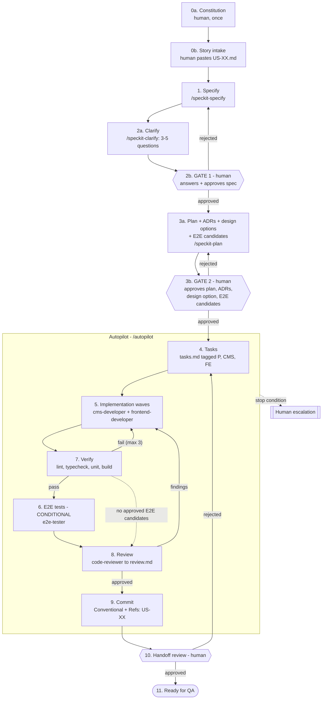

# Agentic Flow — from functional user story to QA handoff

## Overview

**Tool:** Claude Code. Its native subagents (`.claude/agents/`), skills (`.claude/skills/`) and context file (`CLAUDE.md`) map 1:1 to the brief's requirements and are versioned as plain Markdown in the repo.

**Method:** Spec-Driven Development with [GitHub Spec Kit](https://github.com/github/spec-kit), adapted to **two human gates** only. Standard Spec Kit invites a human review after every phase; we cut that to the two points where a human adds the most value — *what* to build (spec) and *how* to build it (plan). Everything after the plan runs on autopilot, bounded by explicit stop conditions. Goal: as little friction as possible without losing control.

**Governance:**
- `.specify/memory/constitution.md` — engineering principles and when agents must stop and ask. Written once by the human.
- `CLAUDE.md` — repository map, commands, stack rules, plan-phase additions, traceability rules. Read by every agent.

## Diagram

- **Step 6 is conditional:** it runs only when `plan.md` has E2E candidates approved at Gate 2; otherwise the flow goes straight from 7 to 8.
- **Stop conditions** (constitution §3) can interrupt the autopilot at any point: a new external dependency, a breaking API contract change, or a test/build still failing after 3 self-correction attempts.

## Steps

Steps 2 and 3 each have an **AI substep (a)** followed by a **human, non-AI substep (b)**: the gate.

| # | Step | Description | AI used? | AI, agent, subagent or skill | Deliverable | Human in the loop |
|---|------|-------------|----------|------------------------------|-------------|-------------------|
| 0a | Constitution | Engineering principles and stop conditions shared by all agents. | No | — | `.specify/memory/constitution.md` | Human writes it once. Only the human changes it. |
| 0b | Story intake | The functional user story is pasted verbatim, as the root of traceability. | No | — | `docs/user-stories/US-XX.md` | Human copies it from the business source. AI never edits it. |
| 1 | Specify | Turns the story into a verifiable spec: numbered FR-XXX, Given/When/Then scenarios, edge cases, detected gaps. | Yes | Claude Code main session (orchestrator), Opus 5.5, skill `speckit-specify` | `specs/NNN-us-XX-<slug>/spec.md` (Status: Draft) | — (reviewed at 2b) |
| 2a | Clarify | Finds the most critical gaps and asks the human 3–5 targeted questions. | Yes | Orchestrator, skill `speckit-clarify` | Questions in session; answers encoded in `spec.md` › Clarifications | — |
| 2b | **Gate 1 — Spec approval** | Human answers the questions and reviews the spec against the original story: right scope, no invented requirements, testable criteria. | **No** | — | `spec.md` Status → `Approved (Gate 1) — <date>` | **Human.** Approves, or rejects with comments → back to 1/2a with the feedback. Corrections stay visible in Clarifications and the session log. |
| 3a | Plan | Designs the technical solution; writes ADRs for architectural decisions; proposes 2–3 design options per client-facing view; proposes E2E candidates (critical flows only). | Yes | Orchestrator, skills `speckit-plan`, `ui-ux-guidelines`, `angular-conventions`, `strapi-conventions` | `specs/.../plan.md`, `docs/adr/NNNN-*.md` (Proposed) | — (reviewed at 3b) |
| 3b | **Gate 2 — Plan approval** | Human checks for over-engineering and real ADR alternatives, picks a design option, approves or rejects each E2E candidate. | **No** | — | `plan.md` Status → `Approved (Gate 2) — <date>`; ADRs → Accepted; E2E candidates marked Approved/Rejected | **Human.** Approves, or rejects with comments → back to 3a. |
| 4 | Tasks | Breaks the plan into tasks tagged `[P]` (parallel), `[CMS]`/`[FE]` (owner) and `US-XX`/`FR-XXX`. | Yes | Orchestrator, skill `autopilot` (Spec Kit `tasks-template.md`) | `specs/.../tasks.md` | None (autopilot). |
| 5 | Implementation waves | Executes tasks; `[P]` groups run in parallel subagents, dependent tasks in sequence. Unit tests are written with the code. | Yes | Subagents `cms-developer` (Sonnet, skill `strapi-conventions`) and `frontend-developer` (Sonnet, skills `angular-conventions`, `ui-ux-guidelines`) | Code in `cms/` and `frontend/src/`, unit tests `*.spec.ts` | None, unless a stop condition fires. |
| 6 | E2E tests — *conditional* | Writes Playwright tests from the spec's scenarios for the approved critical flows only. A spec mismatch is reported as a defect, never "fixed" in the test. | Yes | Subagent `e2e-tester` (Sonnet) | `frontend/e2e/*.spec.ts` | **Runs only if** E2E candidates were approved at Gate 2; skipped otherwise. |
| 7 | Verify | Lint, typecheck, unit tests and CMS build after each wave; automatic fixes. | Yes | Orchestrator (Bash: `npm --prefix frontend run verify`, `npm --prefix cms run build`) | Green checks | Human only if still failing after 3 attempts. |
| 8 | Review | Independent review of the diff against spec, plan, ADRs, constitution and conventions. Blocker/Major findings go back to the developer agents; round 2 verifies them. | Yes | Subagent `code-reviewer` (Opus — a different model from the implementers) | `specs/.../review.md` (findings, status, resolution commit) | Human only for findings still open after round 2. |
| 9 | Commit | Atomic Conventional Commits per verified unit, with `Refs: US-XX` (plus `R-NN` for review fixes). Only the orchestrator commits. | Yes | Orchestrator | Git history | None. |
| 10 | Handoff review | Human runs the app, reads the handoff summary and `review.md`, checks the acceptance scenarios by hand. | **No** | — | Handoff summary and approval in the session log | **Human.** Approves, or rejects: feedback becomes new tasks → back to 4. |
| 11 | Ready for QA | The increment is handed to QA. | No | — | Branch/PR ready | QA team. |

## Traceability

`docs/user-stories/US-XX.md` → `specs/NNN-us-XX-*/spec.md` (FR-XXX) → `docs/adr/NNNN-*.md` (Related: US-XX) → `tasks.md` (US-XX, FR-XXX) → code and tests (`describe('US-XX · FR-XXX …')`) → `review.md` (R-NN) → commits (`Refs: US-XX`).

## Agents and skills

| Component | Type | Responsibility | Model |
|-----------|------|----------------|-------|
| Main session | Orchestrator | Runs Spec Kit skills, holds the gates, runs autopilot, commits | Opus 5.5 |
| `cms-developer` | Subagent | Strapi content types, seed, permissions | Sonnet |
| `frontend-developer` | Subagent | Angular features and unit tests | Sonnet |
| `e2e-tester` | Subagent (conditional) | Playwright tests for approved critical flows | Sonnet |
| `code-reviewer` | Subagent | Independent review → `review.md` | Opus |
| `autopilot` | Custom skill | Procedure: tasks → waves → verify → e2e → review → commit | — |
| `angular-conventions` | Custom skill | Angular project knowledge | — |
| `strapi-conventions` | Custom skill | Strapi project knowledge | — |
| `ui-ux-guidelines` | Custom skill | Brand-based UI/UX guidelines: tokens, components, a11y, design options | — |
| `speckit-*` | Spec Kit skills | Specify, clarify, plan, tasks | — |

## Questions

### What would we do differently with a team of 5 developers?
_To be completed._

### Which part of the flow did not work as expected and how was it adjusted?
_Journal, filled as it happens:_
- **2026-11-21** — The first flow design started at "the human describes the functionality", skipping the business input. Added step 0b (verbatim story intake) so the flow starts from the functional user story and traceability has a fixed root.
- **2026-11-21** — The first design ran the e2e agent on every feature. Changed to conditional: the orchestrator proposes critical candidates at Gate 2 and only approved ones are built, to avoid low-value e2e tests.
- **2026-11-21** — The first design had no review step and no named subagents. Added `code-reviewer` with a two-round loop and versioned agent definitions.

### At which points did we decide not to use AI and why?
- **Constitution (0a):** the rules that govern the agents must come from the human, not from the agents.
- **Story intake (0b):** the business wording must stay untouched to be a reliable source of truth.
- **Gates 1 and 2 (2b, 3b) and handoff review (10):** approval is a human responsibility by definition.
- _More to be added as they happen._
